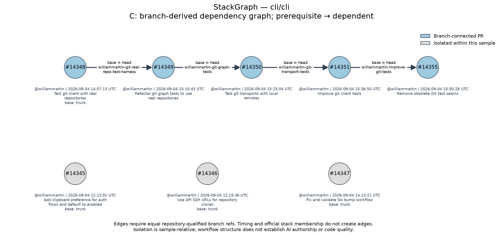

# StackGraph results

This is a purposive public-data case study, not a performance benchmark. General identification performance and workflow legitimacy are **inconclusive**.

Sample: 8 PRs from `cli/cli`. Observed creation dates: 2026-09-04. Branch relationships and stack membership are retrieval-time snapshots.

## Three comparisons

| Comparison | Observed output |
| --- | --- |
| A: simplified time heuristic, 60-minute successive gaps | 2 groups; 16 unordered co-grouped pairs |
| B: official GitHub stack membership | 1 observed stack(s); 10 unordered co-member pairs |
| C: branch-derived targeting graph | 8 nodes, 4 directed edges; 4 weak components |

A is a simplified creation-time grouping heuristic, not AgentScan or its identity scoring logic. AgentScan was not run; this is not a comparison of AgentScan classifications or detection accuracy.

A's groups:

- #14345, #14346
- #14347, #14348, #14349, #14350, #14351, #14355

B's official memberships:

- `cli/cli/stack/14352`: #14348, #14349, #14350, #14351, #14355
- cli/cli#14345: `no_membership_observed`
- cli/cli#14346: `no_membership_observed`
- cli/cli#14347: `no_membership_observed`

C's edges (prerequisite → dependent):

- cli/cli#14348 → cli/cli#14349; equal branch `cli/cli:williammartin-git-real-repo-test-harness`.
- cli/cli#14349 → cli/cli#14350; equal branch `cli/cli:williammartin-git-graph-tests`.
- cli/cli#14350 → cli/cli#14351; equal branch `cli/cli:williammartin-git-transport-tests`.
- cli/cli#14351 → cli/cli#14355; equal branch `cli/cli:williammartin-improve-git-tests`.

Isolated within this sample: #14345, #14346, #14347. DAG: True. Cycle components: 0.

A groups 6 pairs that C places in different components. C has 0 component pairs separated by A. B and C share 10 co-membership pairs, with 0 disagreements. These counts describe agreement, not accuracy.

## Sensitivity of the time baseline

| Maximum successive gap (minutes) | Groups | Co-grouped pairs |
| --- | --- | --- |
| 15 | 3 | 11 |
| 60 | 2 | 16 |
| 180 | 1 | 28 |

The thresholds are illustrative and were not optimized. Single-link groups can span longer than the gap threshold. Only sampled creation events are included; this is not a complete repository event stream.

## Evidence and interpretation

The official membership and branch graph are shown above. The following selected author statements provide additional case context; each presence flag is checked against the saved body. Text was inspected after case selection and is not a model input or an independent label set.

- [cli/cli#14349](https://github.com/cli/cli/pull/14349): `PR #14348 provides the shared real-repository harness this layer builds on.` (present in saved body: True).
- [cli/cli#14350](https://github.com/cli/cli/pull/14350): `This is layer 3 above draft PR #14349` (present in saved body: True).
- [cli/cli#14351](https://github.com/cli/cli/pull/14351): `Parent draft: #14350.` (present in saved body: True).
- [cli/cli#14355](https://github.com/cli/cli/pull/14355): `This is the final code layer above draft PR #14351.` (present in saved body: True).

The manifest designates the following structural controls:

| PR | Subject | Base | Official status |
| --- | --- | --- | --- |
| [#14345](https://github.com/cli/cli/pull/14345) | Add clipboard preference for auth flows and default to enabled | `trunk` | `no_membership_observed` |
| [#14346](https://github.com/cli/cli/pull/14346) | Use API SSH URLs for repository clones | `trunk` | `no_membership_observed` |
| [#14347](https://github.com/cli/cli/pull/14347) | Fix and validate Go bump workflow | `trunk` | `no_membership_observed` |

These are snapshot-specific structural controls, not independently established historical negatives. No claim is made that they lack all semantic dependencies.

C adds an order and a concrete branch reason for each connection that A cannot supply. The observed agreement with B is expected from GitHub's branch-chain definition; it cannot establish predictive accuracy. No independently validated labels are available, so **precision and recall are not reported** (JSON values are null). This small selected example supports descriptive usefulness only. It cannot show general detection performance, maintainer intent, code quality, or whether a workflow is legitimate.

Workflow structure and AI authorship are separate questions. Some saved PR bodies contain authorship disclosures; the pipeline does not parse or score them. Timing, graph position, or stack membership cannot establish AI authorship.

## Provenance

Every source body is saved under `data/cache/`, with retrieval time, HTTP status, source URL, API version, and a SHA-256 checksum. `artifacts/analysis.json` contains the complete normalized comparison. `artifacts/execution.json` records the last run and package versions. [validation.md](validation.md) records executed checks and their observed outcomes.

| Source | Retrieved (UTC) | HTTP |
| --- | --- | --- |
| [API JSON](https://api.github.com/repos/cli/cli/pulls/14345) | 2026-10-28T05:01:46.795156+00:00 | 200 |
| [API JSON](https://api.github.com/repos/cli/cli/stacks?pull_request=14345&per_page=100) | 2026-10-28T05:01:48.854289+00:00 | 200 |
| [API JSON](https://api.github.com/repos/cli/cli/pulls/14346) | 2026-10-28T05:01:50.284642+00:00 | 200 |
| [API JSON](https://api.github.com/repos/cli/cli/stacks?pull_request=14346&per_page=100) | 2026-10-28T05:01:51.066046+00:00 | 200 |
| [API JSON](https://api.github.com/repos/cli/cli/pulls/14347) | 2026-10-28T05:01:52.472191+00:00 | 200 |
| [API JSON](https://api.github.com/repos/cli/cli/stacks?pull_request=14347&per_page=100) | 2026-10-28T05:01:53.691380+00:00 | 200 |
| [API JSON](https://api.github.com/repos/cli/cli/pulls/14348) | 2026-10-28T05:01:54.704925+00:00 | 200 |
| [API JSON](https://api.github.com/repos/cli/cli/stacks?pull_request=14348&per_page=100) | 2026-10-28T05:01:55.817656+00:00 | 200 |
| [API JSON](https://api.github.com/repos/cli/cli/pulls/14349) | 2026-10-28T05:01:57.404733+00:00 | 200 |
| [API JSON](https://api.github.com/repos/cli/cli/stacks?pull_request=14349&per_page=100) | 2026-10-28T05:01:58.859782+00:00 | 200 |
| [API JSON](https://api.github.com/repos/cli/cli/pulls/14350) | 2026-10-28T05:02:00.529681+00:00 | 200 |
| [API JSON](https://api.github.com/repos/cli/cli/stacks?pull_request=14350&per_page=100) | 2026-10-28T05:02:01.525640+00:00 | 200 |
| [API JSON](https://api.github.com/repos/cli/cli/pulls/14351) | 2026-10-28T05:02:02.574110+00:00 | 200 |
| [API JSON](https://api.github.com/repos/cli/cli/stacks?pull_request=14351&per_page=100) | 2026-10-28T05:02:03.874771+00:00 | 200 |
| [API JSON](https://api.github.com/repos/cli/cli/pulls/14355) | 2026-10-28T05:02:05.535690+00:00 | 200 |
| [API JSON](https://api.github.com/repos/cli/cli/stacks?pull_request=14355&per_page=100) | 2026-10-28T05:02:06.325819+00:00 | 200 |

## Diagnostics

No graph or membership warnings.
